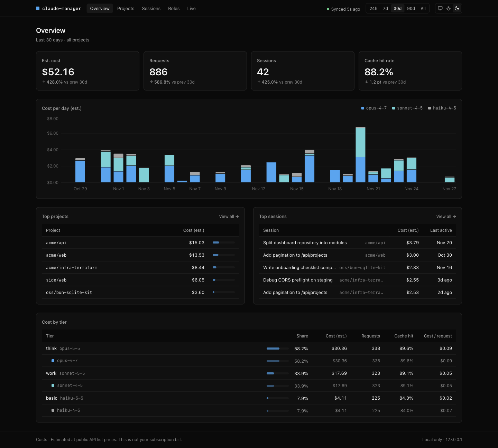
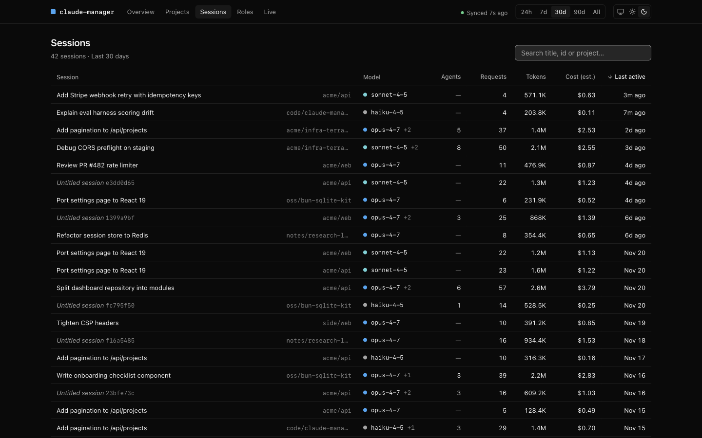
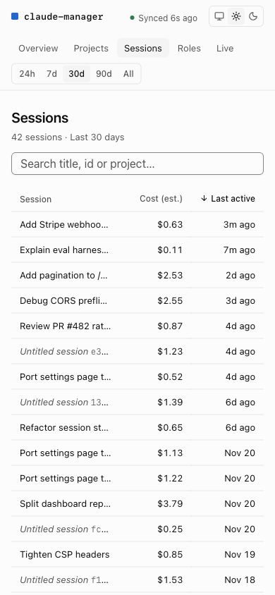

# claude-manager

Smart model roles and local usage analytics for Claude Code.

[](https://github.com/makurosolusi/claude-manager/releases/latest)
[](#requirements)



## The problem

Without a split, every task in a Claude Code session runs on the same expensive model. A manager/worker swarm needs the split: planning on a strong model, routine edits on a cheaper one. Building it by hand leaves four gaps:

- **One model for every task.** Planning, coding and lookups all run on the same expensive model. claude-manager maps roles to three tiers: think (opus), work (sonnet) and basic (haiku).
- **No role split.** Without roles, a swarm means writing agent files by hand. claude-manager installs six preset roles as Claude Code subagents, and `roles add` creates your own.
- **No visibility into usage or cost.** You cannot see tokens or estimated cost per model, role or project. `stats` and the local dashboard show both.
- **Model renames touch many files.** A new model ID means editing every role file. `tier set` changes one setting, and the role files stay the same.

## Key features

- **Tiered role swarm.** Each role has a tier: think (opus), work (sonnet) or basic (haiku).
- **One-command model changes.** `tier set` changes the model ID behind a tier and re-applies every install.
- **Safe install and uninstall.** `install --dry-run` previews changes. Files that claude-manager did not create are not overwritten without `--force`, and forced overwrites are backed up. `uninstall` reverts exactly what `install` wrote.
- **Local analytics.** `sync` imports Claude Code transcripts into a local SQLite database. `stats` prints tokens and estimated cost by model, role, project or day.
- **Local dashboard.** A read-only web UI over the same data.
- **No network calls for analytics.** `sync`, `stats` and the dashboard do not contact the internet. The dashboard listens on 127.0.0.1 only.
- **Single binary.** `update` downloads the latest release, checks its SHA256 checksum, and replaces the binary.

### Roles and tiers

```
Role (manager, coder, ...) -> Tier (think/work/basic) -> Alias (opus/sonnet/haiku) -> Model ID
   .claude/agents/<role>.md                                  frontmatter `model:`      settings.json env ANTHROPIC_DEFAULT_*_MODEL
```

| Role | Tier | Tools |
|---|---|---|
| manager | think | Agent, Read, Grep, Glob, TaskCreate, TaskGet, TaskList, TaskUpdate, TodoWrite |
| architect | think | Read, Grep, Glob, WebSearch, WebFetch |
| researcher | basic | Read, Grep, Glob, WebSearch, WebFetch |
| coder | work | Everything except Agent |
| reviewer | work | Read, Grep, Glob, Bash |
| writer | basic | Read, Grep, Glob, Edit, Write |

The manager can also pick a cheaper or stronger model for a single task through the Agent tool's `model` parameter.

## Requirements

- **OS:** macOS and Linux, on x64 or arm64. The Windows build (`claude-manager-windows-x64.exe`) is experimental. It has no install script and no self-update.
- **Claude Code:** the `claude` CLI on your `PATH`. No minimum version is enforced. `doctor` only checks that `claude --version` runs.
- **Install script:** `curl`, and either `sha256sum` or `shasum` for checksum verification.
- **Dashboard:** a modern web browser.
- **Development:** Bun 1.4.2 (the `packageManager` field in `package.json`; the release workflow uses the same version).

## Install

```bash
curl -fsSL https://github.com/makurosolusi/claude-manager/releases/latest/download/install.sh | sh
```

The script picks the binary for your OS and arch, verifies it against `SHA256SUMS`, and installs it.

| Env | Default | Meaning |
|---|---|---|
| `CLAUDE_MANAGER_VERSION` | `latest` | Release to install, e.g. `0.1.0` or `v0.1.0` |
| `CLAUDE_MANAGER_INSTALL_DIR` | `~/.local/bin` | Where the binary goes. The script warns if this directory is not in `PATH`. |

To install manually, download `claude-manager-<os>-<arch>` and `SHA256SUMS` from the Releases page, then verify and install:

```bash
grep ' claude-manager-darwin-arm64$' SHA256SUMS | shasum -a 256 -c   # Linux: sha256sum -c
mkdir -p ~/.local/bin
chmod +x claude-manager-darwin-arm64 && mv claude-manager-darwin-arm64 ~/.local/bin/claude-manager
```

Verify the install:

```bash
claude-manager -v        # prints the version
claude-manager doctor    # checks the claude CLI, installs and settings.json
```

## Quick start

1. Install the binary (see [Install](#install)) and run `claude-manager -v`.
2. Run `claude-manager doctor`. Fix any `FAIL` line before you continue.
3. Preview, then install the roles: `claude-manager install --dry-run`, then `claude-manager install`.
4. Start a swarm session: `claude --agent manager`.
5. Open the dashboard: `claude-manager dashboard`, then go to http://127.0.0.1:5757. It syncs on start and picks up new transcript data every 5 seconds.

## Usage

### Role setup

```bash
claude-manager install                        # writes to ~/.claude (user scope)
claude-manager install --scope project        # writes to ./.claude instead
claude-manager install --main-agent manager   # also make manager the main session agent
claude-manager install --force                # back up and overwrite files not managed by claude-manager
claude-manager roles                          # list roles with tier, model and tools
claude-manager roles set architect fable      # pin a model to one role
claude-manager roles set architect default    # remove that override
claude-manager roles add ui-ux --tier work --tools Read,Grep,Glob,Edit,Write \
  --description "Designs UI layouts, accessibility and visual polish"
claude-manager roles rm ui-ux                 # delete a custom role, or disable a preset
claude-manager roles enable writer            # re-enable a preset disabled with roles rm
claude-manager tier                           # show the model behind each tier
claude-manager tier set think claude-opus-5-5
claude-manager uninstall                      # revert what install wrote (user scope)
```

`install` and `uninstall` accept `--dry-run` to show changes without writing. `uninstall --scope project` reverts the project install. Files you edited after installing are kept and reported.

### Analytics

```bash
claude-manager sync                                       # import new transcript lines into the local DB
claude-manager stats                                      # by model, last 30 days
claude-manager stats --by role --since 7d
claude-manager stats --by day --since 2026-11-01 --project my-app --json
claude-manager dashboard                                  # http://127.0.0.1:5757
claude-manager dashboard --port 8080
```

- `stats --by` takes `model`, `role`, `project` or `day` (default `model`).
- `--since` takes `7d`, `24h` or a date (default `30d`). `--limit` caps rows (default 20).
- `--project` matches projects whose path contains the text.
- `stats` syncs first, so a separate `sync` is optional.

### Maintenance

```bash
claude-manager doctor                 # health checks; exits 1 if any check fails
claude-manager update --check         # is a newer release available?
claude-manager update                 # download, verify SHA256, replace the binary
claude-manager help stats             # show the options for one command
```

`claude-manager <command> --help` shows the same options.

## Dashboard

Start it with `claude-manager dashboard`. It is read-only and serves a single page app with these views:

- **Overview** (`#/`): four KPI cards (estimated cost, requests, sessions, cache hit rate), each with its change against the previous window of the same length when there is one (not for `all`). It also shows daily cost stacked by model, top projects, top sessions, and cost by tier.
- **Sessions** (`#/sessions`): a sortable table with model, agents, requests, tokens, cost and last active. Sort by last active, cost, requests, tokens or agents. The search box matches title, id or project; press `/` to focus it. A project filter shows as a removable chip.
- **Projects** (`#/projects`): usage per project, paginated. A row opens Sessions filtered to that project.
- **Roles** (`#/roles`): usage per role and model, paginated.
- **Live** (`#/live`): sessions active in the last 15 minutes, with estimated context left. Refreshes every 5 seconds.
- **Session detail** (`#/sessions/<id>`): one session, its subagents, and its prompt timeline. With `storePromptText` set to `false`, no prompt text is stored.

The range picker sets the time window for each page: `24h`, `7d`, `30d` (default), `90d` or `all`. The picker is disabled on Live and session detail, which do not filter by time.

Page state lives in the URL hash, so a reload or a shared link keeps the same view. On Sessions, `q` (search), `sort`, `dir`, `project` and `page` are in the URL alongside `range`. Default values are left out of the URL.

Overview and Sessions have the redesigned layout.

| Overview, dark | Overview, light |
|---|---|
|  |  |
| Sessions, dark | Sessions, mobile |
|  |  |

## Usage analytics and privacy

- `sync` reads `~/.claude/projects/**/*.jsonl` (or `$CLAUDE_CONFIG_DIR/projects`) incrementally, reading only new bytes, into `~/.claude-manager/data.db`.
- `sync`, `stats` and `dashboard` make no network requests. Only `install.sh`, `update` and `update --check` contact GitHub.
- Prompt text is stored locally by default. Set `storePromptText` to `false` to keep metadata only.
- The dashboard is read-only. It listens on 127.0.0.1 only. Its `/api` routes reject any request whose Host header is not `127.0.0.1:<port>` or `localhost:<port>`.
- Costs are estimates at public API list prices, priced by the model that served each request. They are not your bill, and subscription plans are not billed this way.
- Prices come from built-in defaults, then Claude Code's local price cache, then `~/.claude-manager/pricing.json`. The last source wins for each model ID. Costs are recomputed when prices change.
- Background calls that Claude Code does not write to transcripts (for example, title generation) are not counted.
- Remaining context is an estimate. Transcripts do not record the context window, so it is inferred from the model ID.

## Configuration

Environment variables:

| Variable | Default | Meaning |
|---|---|---|
| `CLAUDE_MANAGER_HOME` | `~/.claude-manager` | State directory: `data.db`, `config.json`, `pricing.json`, backups |
| `CLAUDE_CONFIG_DIR` | `~/.claude` | Claude Code config directory. Transcripts are read from its `projects` folder, and user-scope installs go here. |
| `CLAUDE_MANAGER_DEBUG` | unset | Print stack traces for unexpected errors |

`~/.claude-manager/config.json` holds your settings. The CLI also writes tier, role and install state to this file.

| Field | Default | Meaning |
|---|---|---|
| `storePromptText` | `true` | Store prompt text in `data.db`. `false` keeps metadata only. |
| `dashboardPort` | `5757` | Port for `dashboard`. `--port` overrides it. |

`pricing.json` maps a model ID to rates in USD per million tokens, in the same shape as Claude Code's price cache:

```json
{
  "claude-sonnet-5-5": {
    "inputTokens": 2, "outputTokens": 10,
    "promptCacheWriteTokens": 2.5, "promptCacheWrite1hTokens": 4, "promptCacheReadTokens": 0.1
  }
}
```

## Troubleshooting

| Symptom | Cause | Fix |
|---|---|---|
| `claude-manager: command not found` | The install directory is not in `PATH`. `install.sh` prints `warning: <dir> is not in PATH`. | Add `export PATH="$HOME/.local/bin:$PATH"` to your shell profile, then open a new shell. |
| `error: port 5757 is in use; try --port <n>` | Another process holds the port, often a running dashboard. | Stop the other process, run `claude-manager dashboard --port <n>`, or set `dashboardPort` in `config.json`. |
| Empty dashboard, or `stats` prints `no requests since ...` | No transcripts were found. `sync` reports `scanned 0 transcripts`. | Claude Code writes transcripts to `~/.claude/projects`, or to `$CLAUDE_CONFIG_DIR/projects` if that variable is set. Set it to the directory Claude Code uses, then run `claude-manager sync`. |
| Costs differ from your bill | Costs are estimates at API list prices. Subscription plans are not billed this way, and background calls are not in transcripts. | Expected. See [Usage analytics and privacy](#usage-analytics-and-privacy). |
| `warning: no rates for <model> (cost shown as 0)` | The model has no rates in the built-in table, Claude Code's cache, or `pricing.json`. | Add the model ID to `~/.claude-manager/pricing.json`, then run `claude-manager sync`. |
| `update` fails with `self-update is not supported on Windows` | Self-update is not built for the Windows binary. | Download the new `.exe` from the Releases page. |
| `doctor` exits 1 | A check printed `FAIL`. `claude CLI not found in PATH` means Claude Code is missing or not on `PATH`. `cannot parse <path> (Claude Code requires strict JSON)` means `settings.json` is invalid. | Install Claude Code or fix `PATH`, or fix the JSON in the named file. `warn` lines do not change the exit code. |
| `Permission denied` when running a manually downloaded binary | The file is not executable. The shell prints this message, not claude-manager. | Run `chmod +x` on the binary, for example `chmod +x ~/.local/bin/claude-manager`. |

## Development

```bash
bun install
bun test
bun run typecheck
bun run build        # dist/claude-manager for this machine
bun run build:all    # all release targets
bun run dev dashboard   # run the dashboard from source
```

In development, `bunfig.toml` runs Tailwind for the dashboard's HTML import. Compiled builds pass the Tailwind plugin through `scripts/build.ts` instead. The binary ignores `.env` and `bunfig.toml` in the user's working directory.

## Releasing

1. Bump `version` in `package.json`.
2. Add a `CHANGELOG.md` entry for that version.
3. Push a tag named `v<version>`, for example `git tag v0.1.0 && git push origin v0.1.0`.

The `release` workflow checks that the tag matches `package.json`, runs tests, the typecheck and `build:all`, then publishes the binaries, `SHA256SUMS` and `install.sh` as a GitHub release.

## Uninstall

```bash
claude-manager uninstall                    # user scope (~/.claude)
claude-manager uninstall --scope project    # project scope (./.claude)
claude-manager uninstall --dry-run          # show what would change
claude-manager uninstall --purge-data       # also delete ~/.claude-manager (only when no scope is still installed)
```

`uninstall` removes the role files and settings keys that `install` wrote, and it leaves your own agents alone. It does not delete the binary. Remove it with `rm ~/.local/bin/claude-manager`, or from the directory you installed it to.
