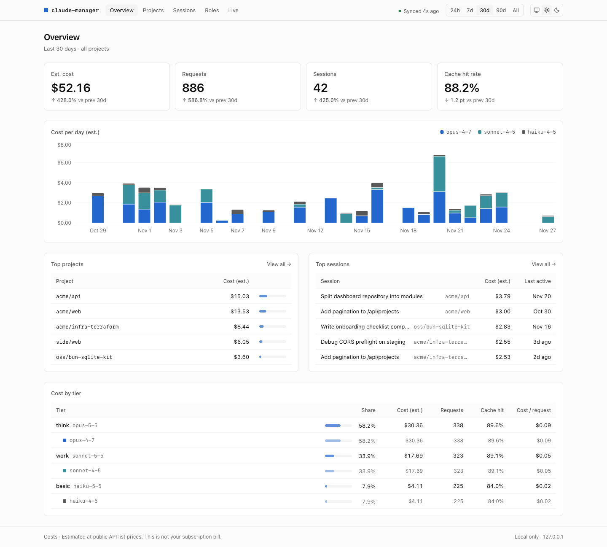
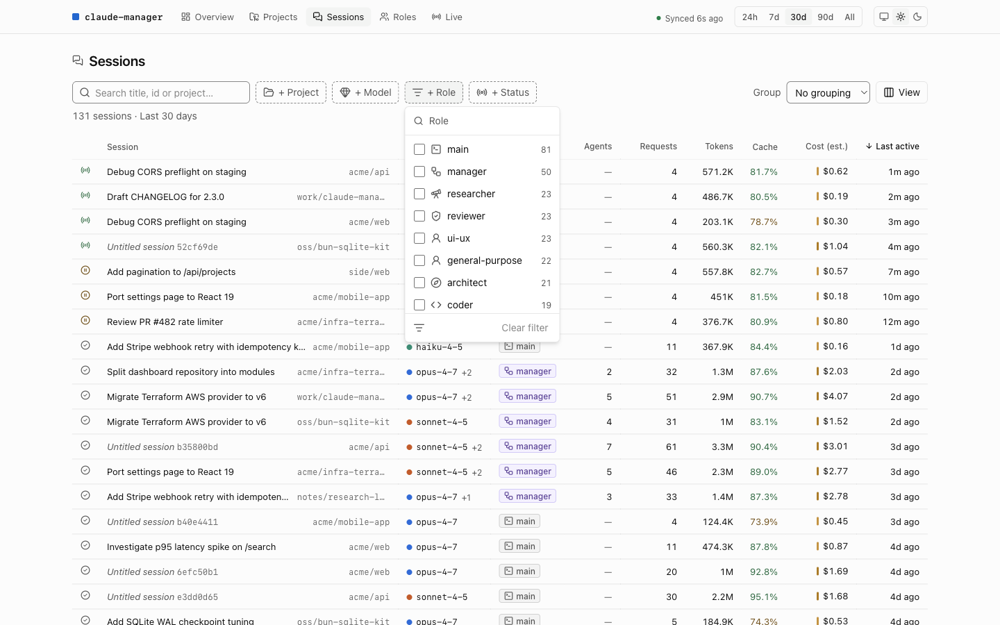
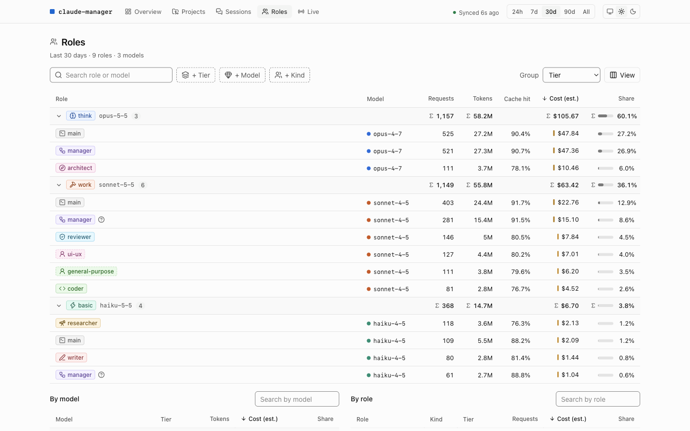
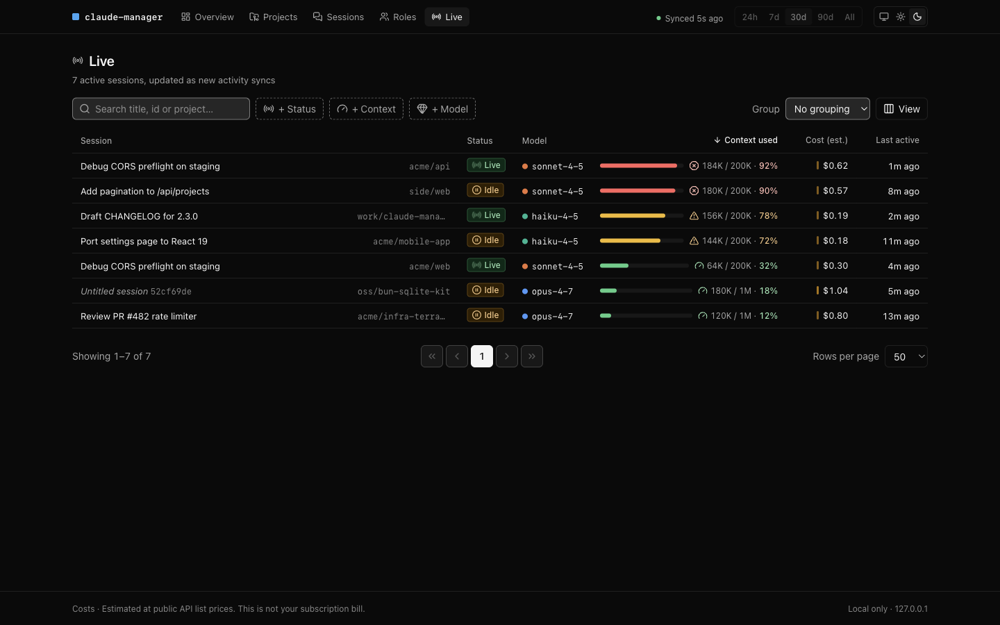
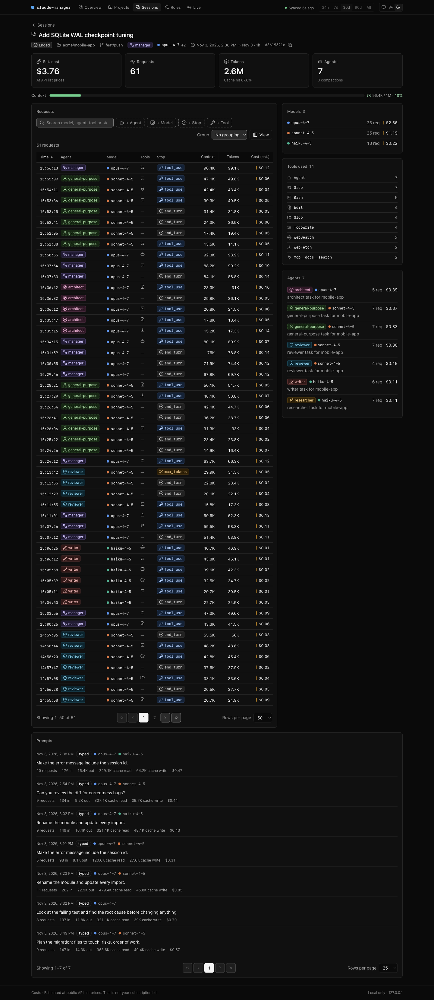
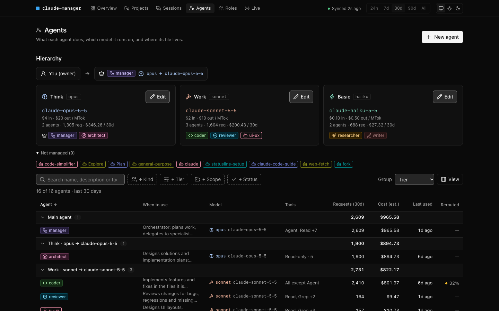

# claude-manager

Smart model roles and local usage analytics for Claude Code.

[](https://github.com/makurosolusi/claude-manager/releases/latest)
[](LICENSE)
[](#requirements)


## The problem

Without a split, every task in a Claude Code session runs on the same expensive model. A manager/worker swarm needs the split: planning on a strong model, routine edits on a cheaper one. Building it by hand leaves four gaps:

- **One model for every task.** Planning, coding and lookups all run on the same expensive model. claude-manager maps roles to three tiers: think (opus), work (sonnet) and basic (haiku).
- **No role split.** Without roles, a swarm means writing agent files by hand. claude-manager installs six preset roles as Claude Code subagents, and `roles add` creates your own.
- **No visibility into usage or cost.** You cannot see tokens or estimated cost per model, role or project. `stats` and the local dashboard show both.
- **Model renames touch many files.** A new model ID means editing every role file. `tier set` changes one setting, and the role files stay the same.

## Key features

- **Tiered role swarm.** Each role has a tier: think (opus), work (sonnet) or basic (haiku).
- **One-command model changes.** `tier set` changes the model ID behind a tier and re-applies every install.
- **Safe install and uninstall.** `install --dry-run` previews changes. Files that claude-manager did not create are not overwritten without `--force`, and forced overwrites are backed up. `uninstall` reverts exactly what `install` wrote.
- **Permission policy.** Presets (Strict, Balanced, Autonomous) decide per role what workers may do without asking. Push, publish, deploy and recursive delete ask you, and secrets are always denied. Those owner checks read the command text, so unusual shell forms may slip past; Balanced (recommended) keeps shell on ask, Autonomous does not. It works through a hook in the same binary, and `uninstall` restores `settings.json` byte for byte.
- **Local analytics.** `sync` imports Claude Code transcripts into a local SQLite database. `stats` prints tokens and estimated cost by model, role, project or day.
- **Local dashboard.** A web UI over the same data, with an Agents page to manage roles and tier models. `--read-only` disables writes.
- **No network calls for analytics.** `sync`, `stats` and the dashboard do not contact the internet. The dashboard listens on 127.0.0.1 only.
- **Single binary.** `update` downloads the latest release, checks its SHA256 checksum, and replaces the binary.

### Roles and tiers

```
Role (manager, coder, ...) -> Tier (think/work/basic) -> Alias (opus/sonnet/haiku) -> Model ID
   .claude/agents/<role>.md                                  frontmatter `model:`      settings.json env ANTHROPIC_DEFAULT_*_MODEL
```

| Role | Tier | Tools |
|---|---|---|
| manager | think | Agent, Read, Grep, Glob, TaskCreate, TaskGet, TaskList, TaskUpdate, TodoWrite |
| architect | think | Read, Grep, Glob, WebSearch, WebFetch |
| researcher | basic | Read, Grep, Glob, WebSearch, WebFetch |
| coder | work | Everything except Agent |
| reviewer | work | Read, Grep, Glob, Bash |
| writer | basic | Read, Grep, Glob, Edit, Write |

The manager can also pick a cheaper or stronger model for a single task through the Agent tool's `model` parameter.

## Requirements

- **OS:** macOS and Linux, on x64 or arm64. The Windows build (`claude-manager-windows-x64.exe`) is experimental. It has no install script and no self-update.
- **Claude Code:** the `claude` CLI on your `PATH`. No minimum version is enforced. `doctor` only checks that `claude --version` runs.
- **Install script:** `curl`, and either `sha256sum` or `shasum` for checksum verification.
- **Dashboard:** a modern web browser.
- **Development:** Bun 1.4.2 (the `packageManager` field in `package.json`; the release workflow uses the same version).

## Install

```bash
curl -fsSL https://github.com/makurosolusi/claude-manager/releases/latest/download/install.sh | sh
```

The script picks the binary for your OS and arch, verifies it against `SHA256SUMS`, and installs it.

| Env | Default | Meaning |
|---|---|---|
| `CLAUDE_MANAGER_VERSION` | `latest` | Release to install, e.g. `0.1.0` or `v0.1.0` |
| `CLAUDE_MANAGER_INSTALL_DIR` | `~/.local/bin` | Where the binary goes. The script warns if this directory is not in `PATH`. |

To install manually, download `claude-manager-<os>-<arch>` and `SHA256SUMS` from the Releases page, then verify and install:

```bash
grep ' claude-manager-darwin-arm64$' SHA256SUMS | shasum -a 256 -c   # Linux: sha256sum -c
mkdir -p ~/.local/bin
chmod +x claude-manager-darwin-arm64 && mv claude-manager-darwin-arm64 ~/.local/bin/claude-manager
```

Verify the install:

```bash
claude-manager -v        # prints the version
claude-manager doctor    # checks the claude CLI, installs and settings.json
```

## Quick start

1. Install the binary (see [Install](#install)) and run `claude-manager -v`.
2. Run `claude-manager doctor`. Fix any `FAIL` line before you continue.
3. Preview, then install the roles: `claude-manager install --dry-run`, then `claude-manager install`.
4. Start a swarm session: `claude --agent manager`.
5. Open the dashboard: `claude-manager dashboard`, then go to http://127.0.0.1:5757. It syncs on start and picks up new transcript data while it runs.

## Usage

### Role setup

```bash
claude-manager install                        # writes to ~/.claude (user scope)
claude-manager install --scope project        # writes to ./.claude instead
claude-manager install --main-agent manager   # also make manager the main session agent
claude-manager install --force                # back up and overwrite files not managed by claude-manager
claude-manager roles                          # list roles with tier, model and tools
claude-manager roles set architect fable      # pin a model to one role
claude-manager roles set architect default    # remove that override
claude-manager roles add ui-ux --tier work --tools Read,Grep,Glob,Edit,Write \
  --description "Designs UI layouts, accessibility and visual polish"
claude-manager roles rm ui-ux                 # delete a custom role, or disable a preset
claude-manager roles enable writer            # re-enable a preset disabled with roles rm
claude-manager tier                           # show the model behind each tier
claude-manager tier set think claude-opus-5-5 # full model id only; aliases are refused
claude-manager roles edit coder --tier basic  # edit a role (same result as the dashboard)
claude-manager uninstall                      # revert what install wrote (user scope)
```

`tier set` needs a full model id, because Claude Code requires one in `ANTHROPIC_DEFAULT_*_MODEL`. It refuses aliases (`opus`, `sonnet`, `haiku`, `fable`, `best`, `opusplan`, `default`, `inherit`) and ids longer than 128 characters. The change applies to new Claude Code sessions. Running sessions reload settings and may switch on their next request, so restart them to be sure.

`roles edit <name>` takes `--description`, `--tier`, `--pin <model>`, `--default`, `--tools <A,B|all>`, `--prompt-file <path>`, `--enable` and `--disable`. `--tier`, `--pin` and `--default` are mutually exclusive, and so are `--enable` and `--disable`. Preset roles only accept the model flags (`--tier`, `--pin`, `--default`) and `--enable`/`--disable`; their description, tools and prompt are fixed.

`install` and `uninstall` accept `--dry-run` to show changes without writing. `uninstall --scope project` reverts the project install. Files you edited after installing are kept and reported.

### Permission policy

```bash
claude-manager policy show                        # status, hook state and the per-role matrix
claude-manager policy apply balanced --dry-run    # preview the diff; drop --dry-run to apply
claude-manager policy apply balanced --scope project  # write .claude/settings.local.json instead
claude-manager policy apply balanced --dev-hook    # development only: allow a hook that runs from a source checkout
claude-manager policy set coder shell allow       # override one cell (allow, ask, deny or default)
claude-manager policy escalate off                # worker asks prompt you again; `on` sends them to the manager
claude-manager policy audit --since 7d            # recent hook decisions
claude-manager policy disable                     # revert the settings; `enable` turns it back on
```

Presets are `strict`, `balanced` (recommended) and `autonomous`. Each decides, per role, what workers may do without asking across nine capabilities: read, edit, test, shell, web, agents, git, push and mcp. Owner floors apply in every preset: push, publish, deploy and recursive delete need your approval (detected from the command text, a heuristic, so unusual forms may not be caught), `push` can never be set to `allow`, and `.env*`, keys and credentials are always denied. With escalate on, workers hand these to the manager, and only the manager's session asks you. `apply` accepts `--yes` to skip the confirmation and `--accept-edits` to also start sessions in Accept edits mode; without that flag `defaultMode` is left alone. The hook (`claude-manager hook pre-tool-use`) fails open: if it fails, Claude Code's normal prompts apply. Your own existing rules are kept. With escalate on (the default for new setups; `apply --no-escalate` starts it off), a worker's action (any subagent, including built-in agents such as general-purpose, Explore and Plan) is sent back to the manager instead of prompting you whenever its cell is Ask or Default. The worker gets a deny that tells it to stop and report. Read stays Default, so in-project reads follow Claude Code, and tools the policy does not model are unaffected. Allow and Deny cells and the secret floors do not change. A 0.4.0 policy has escalate unset: re-applying a preset (CLI or dashboard) turns it on, and `--no-escalate` or the unticked dashboard box keeps it off; after that, re-applying keeps your choice. `policy audit` also takes `--role`, `--decision` and `--limit`. Escalated actions are recorded as deny with a rule starting `escalated:`, so `--decision ask` does not list them.

**Limits.** Workers can still reach you through Claude Code's own prompts when:

- the hook is not running (policy off, or the hook failed, since it fails open);
- a tool is not modelled by the policy;
- one of your own `ask` rules in settings matches, because Claude Code still prompts after a hook allow;
- Claude Code's built-in protections apply, such as protected paths and some MCP tools that require interaction.

### Analytics

```bash
claude-manager sync                                       # import new transcript lines into the local DB
claude-manager stats                                      # by model, last 30 days
claude-manager stats --by role --since 7d
claude-manager stats --by day --since 2026-11-01 --project my-app --json
claude-manager dashboard                                  # http://127.0.0.1:5757
claude-manager dashboard --port 8080
claude-manager dashboard --read-only                      # disable all writes (UI hides controls, API returns 403)
```

- `stats --by` takes `model`, `role`, `project` or `day` (default `model`).
- `--since` takes `7d`, `24h` or a date (default `30d`). `--limit` caps rows (default 20).
- `--project` matches projects whose path contains the text.
- `stats` syncs first, so a separate `sync` is optional.

### Maintenance

```bash
claude-manager doctor                 # health checks; exits 1 if any check fails
claude-manager update --check         # is a newer release available?
claude-manager update                 # download, verify SHA256, replace the binary
claude-manager help stats             # show the options for one command
```

`claude-manager <command> --help` shows the same options.

## Dashboard

Start it with `claude-manager dashboard`. It serves a single page app with these views. Analytics pages are read-only. The Agents page can change your agents and tier models unless you start with `--read-only`.

- **Overview** (`#/`): four KPI cards (estimated cost, requests, sessions, cache hit rate), each with its change against the previous window of the same length when there is one (not for `all`). It also shows daily cost stacked by model family, top projects, top sessions, and cost by tier.
- **Sessions** (`#/sessions`): every session with status, model, role, agents, requests, tokens, cache hit rate, cost and last active. Facet filters cover project, model, role and status.
- **Projects** (`#/projects`): usage per project, with the full working directory (`~`-relative) under each name and a copy button. Rows group by folder by default and carry a Kind (Project, Worktree, Temp dir, Home or Other). A row opens Sessions filtered to that project.
- **Roles** (`#/roles`): usage per role and model in one table. A switch picks By role, By model or By tier, and each role links to the Agents page.
- **Agents** (`#/agents`): every agent (preset, custom and external), grouped by level, with its prompt, tools, install files and state, 30-day usage and warnings. A hierarchy panel shows You, the main agent and the Think, Work and Basic tier cards with model, price per MTok and 30-day cost. From here you can create, edit, delete, disable and enable managed agents, and change the model behind a tier. The tier picker shows prices and a 30-day cost estimate, and warns about the affected agents and cross-family changes. Writes need a per-process token and a same-origin request. Every save backs up `config.json` and rolls back if applying fails. Changes apply to new Claude Code sessions. Running sessions reload settings and may switch on their next request, so restart them to be sure.
- **Permission policy** (`#/policy`, linked from Agents): pick a preset and scope, review the diff, then confirm. A per-role matrix editor changes single cells (edited cells are marked), and the owner floors are shown read-only. An Escalation switch sends worker asks to the manager. A "Set up policy" banner on Overview, Agents and agent detail stays until a policy is enforced. Agents also gets an "Effective permission" column on wide screens, and agent detail has a Permissions panel.
- **Policy audit** (`#/policy/audit`): every allow, ask and deny the hook decided, with filters.
- **Live** (`#/live`): sessions active in the last 15 minutes, with a context bar and estimated context left (OK, warning or critical). It refreshes when new data is synced.
- **Session detail** (`#/sessions/<id>`): one session with cost, requests, tokens and context. A summary row lists the models, tools used and cost by role. Tabs hold the Requests table (agent, model, tools, stop reason, context, tokens, cost, with Agent, Model, Stop and Tool filters), a searchable, paginated Agents table, and the Prompts timeline. With `storePromptText` set to `false`, no prompt text is stored.

Colours carry meaning. Opus is blue, sonnet is orange, haiku is teal and fable is plum. Each role has its own colour and icon: preset roles are solid badges, while custom roles (person icon) and external agents such as `general-purpose`, `Explore` or `fork` (bot icon) are outlined. The Kind column in By role says which is which (preset, custom or external). Status, cache hit rate, context level and stop reason have colours too.

A request is **rerouted** when the model that answered is not the model that was asked for, usually because a gateway behind `ANTHROPIC_BASE_URL` remaps models. Rerouted requests are flagged with a warning badge in the session's request table (with a Rerouted filter), a chip in the session header, a marker beside the model on Sessions, a Rerouted column on Roles, and a count under the Requests card on Overview. Hover any of them for the requested and served models. See [Troubleshooting](#troubleshooting).

The tables share one toolkit:

- **Search** over titles, ids and projects (Sessions and Live), roles and models (Roles), or models, agents, tools and stop reasons (session requests). Press `/` to focus the search box.
- **Facet filters** list their values with counts.
- **Group by** shows a subtotal per group. Sessions group by project, model family or status.
- **View** menu: show or hide columns and choose compact or comfortable row density. These two settings are stored in your browser, not in the URL.
- **Pagination** with 25, 50 or 100 rows per page.
- **Sorting** by clicking a column header.

The range picker sets the time window for each page: `24h`, `7d`, `30d` (default), `90d` or `all`. The picker is disabled on Live and session detail, which do not filter by time.

Page state lives in the URL hash, so a reload or a shared link keeps the same view: range, search, filters, group, sort, page and page size. Default values are left out of the URL.

| Overview, dark | Overview, light |
|---|---|
|  |  |
| **Sessions, dark** | **Sessions with the Role filter open** |
|  |  |
| **Roles, grouped by role** | **Live** |
|  |  |
| **Session detail** | **Sessions, mobile** |
|  |  |
| **Agents, hierarchy and agent list** | |
|  | |

The screenshots use generated demo data.

## Usage analytics and privacy

- `sync` reads `~/.claude/projects/**/*.jsonl` (or `$CLAUDE_CONFIG_DIR/projects`) incrementally, reading only new bytes, into `~/.claude-manager/data.db`.
- `sync`, `stats` and `dashboard` make no network requests. Only `install.sh`, `update` and `update --check` contact GitHub.
- Prompt text is stored locally by default. Set `storePromptText` to `false` to keep metadata only.
- The dashboard listens on 127.0.0.1 only. Its `/api` routes reject any request whose Host header is not `127.0.0.1:<port>` or `localhost:<port>`. Its only writes are agent and tier changes from the Agents page (`--read-only` turns them off). They need a per-process token, and they go to `config.json` and your Claude Code agent files and `settings.json`.
- The permission policy audit (`~/.claude-manager/policy-audit.jsonl`, then `data.db`) stores the time, session and agent ids, role, tool name, capability, decision and rule. It does not store tool inputs, paths or commands. Rows are kept 30 days or up to 200,000 rows, and the file rotates at 5 MiB.
- Costs are estimates at public API list prices, priced by the model that served each request. They are not your bill, and subscription plans are not billed this way.
- Prices come from built-in defaults, then Claude Code's local price cache, then `~/.claude-manager/pricing.json`. The last source wins for each model ID. Costs are recomputed when prices change.
- Background calls that Claude Code does not write to transcripts (for example, title generation) are not counted.
- Remaining context is an estimate. Transcripts do not record the context window, so it is inferred from the model ID.

## Configuration

Environment variables:

| Variable | Default | Meaning |
|---|---|---|
| `CLAUDE_MANAGER_HOME` | `~/.claude-manager` | State directory: `data.db`, `config.json`, `pricing.json`, backups |
| `CLAUDE_CONFIG_DIR` | `~/.claude` | Claude Code config directory. Transcripts are read from its `projects` folder, and user-scope installs go here. |
| `CLAUDE_MANAGER_DEBUG` | unset | Print stack traces for unexpected errors |

`~/.claude-manager/config.json` holds your settings. The CLI also writes tier, role and install state to this file.

| Field | Default | Meaning |
|---|---|---|
| `storePromptText` | `true` | Store prompt text in `data.db`. `false` keeps metadata only. |
| `dashboardPort` | `5757` | Port for `dashboard`. `--port` overrides it. |

`pricing.json` maps a model ID to rates in USD per million tokens, in the same shape as Claude Code's price cache:

```json
{
  "claude-sonnet-5-5": {
    "inputTokens": 2, "outputTokens": 10,
    "promptCacheWriteTokens": 2.5, "promptCacheWrite1hTokens": 4, "promptCacheReadTokens": 0.1
  }
}
```

## Troubleshooting

| Symptom | Cause | Fix |
|---|---|---|
| `claude-manager: command not found` | The install directory is not in `PATH`. `install.sh` prints `warning: <dir> is not in PATH`. | Add `export PATH="$HOME/.local/bin:$PATH"` to your shell profile, then open a new shell. |
| `error: port 5757 is in use; try --port <n>` | Another process holds the port, often a running dashboard. | Stop the other process, run `claude-manager dashboard --port <n>`, or set `dashboardPort` in `config.json`. |
| Empty dashboard, or `stats` prints `no requests since ...` | No transcripts were found. `sync` reports `scanned 0 transcripts`. | Claude Code writes transcripts to `~/.claude/projects`, or to `$CLAUDE_CONFIG_DIR/projects` if that variable is set. Set it to the directory Claude Code uses, then run `claude-manager sync`. |
| Costs differ from your bill | Costs are estimates at API list prices. Subscription plans are not billed this way, and background calls are not in transcripts. | Expected. See [Usage analytics and privacy](#usage-analytics-and-privacy). |
| `warning: no rates for <model> (cost shown as 0)` | The model has no rates in the built-in table, Claude Code's cache, or `pricing.json`. | Add the model ID to `~/.claude-manager/pricing.json`, then run `claude-manager sync`. |
| `update` fails with `self-update is not supported on Windows` | Self-update is not built for the Windows binary. | Download the new `.exe` from the Releases page. |
| A role runs on a different model than its tier (for example `coder` on Opus), or the dashboard marks requests as rerouted | The role file requests the right model, but something overrides it. `claude-manager doctor` flags the usual causes: `CLAUDE_CODE_SUBAGENT_MODEL_FORCE`, `ANTHROPIC_BASE_URL` (a gateway can serve another model than the one requested), a project `.claude/agents/<role>.md` that shadows the installed role, or unmapped `ANTHROPIC_DEFAULT_*_MODEL` aliases. Built-in agents (`general-purpose`, `fork`, `Explore`) and any call that omits a role inherit the main conversation model. | Fix what `doctor` reports (unset the variable, remove the shadow file, or re-run `install`). To pin a built-in agent, define a same-named agent with a `model:`. |
| `doctor` exits 1 | A check printed `FAIL`. `claude CLI not found in PATH` means Claude Code is missing or not on `PATH`. `cannot parse <path> (Claude Code requires strict JSON)` means `settings.json` is invalid. | Install Claude Code or fix `PATH`, or fix the JSON in the named file. `warn` lines do not change the exit code. |
| The dashboard says `config.json` is invalid (API error 500) | `~/.claude-manager/config.json` is not valid JSON. | Fix the JSON, or restore a copy from `~/.claude-manager/backups/` (the last 20 are kept). |
| Saving in the dashboard fails with 409 (agent file edited by hand) | An installed agent file was changed after claude-manager wrote it. The dashboard will not overwrite it. | Run `claude-manager install --force`. It overwrites the file and keeps a backup. |
| Workers still ask for every tool | No policy is applied, the hook was removed or edited, or the policy snapshot is stale. | Run `claude-manager doctor` and check whether the policy is enforced and whether the hook was edited. Then run `claude-manager policy apply balanced`. |
| `doctor` says the policy hook points at a moved binary | The hook in `settings.json` still holds the old binary path. | Re-run `claude-manager policy apply <preset>` to rewrite it. |
| A worker says it was blocked and must report to the manager | Escalate is on, so the worker's ask was turned into a deny. | Expected. The manager asks you once. To get worker prompts instead, run `claude-manager policy escalate off`. |
| A built-in agent (general-purpose, Explore) is blocked and reports to the manager | Expected with escalate on: its Ask or Default cell was sent to the manager. | Give the role the right in the matrix or the unknown row, or run `claude-manager policy escalate off`. |
| `another claude-manager process is changing config (pid N); try again` | Another claude-manager command or dashboard write holds `~/.claude-manager/config.lock`. | Wait and retry. If no such process is running, check `pid N`. A lock from a dead process is cleared automatically. See the config lock limits below. |

Config lock limits: the lock checks the holder's pid, which only works on the same machine. On network filesystems, or in containers that share `~/.claude-manager`, it falls back to an age check, and a lock older than 2 minutes is treated as abandoned.
| `Permission denied` when running a manually downloaded binary | The file is not executable. The shell prints this message, not claude-manager. | Run `chmod +x` on the binary, for example `chmod +x ~/.local/bin/claude-manager`. |

## Development

```bash
bun install
bun test
bun run typecheck
bun run build        # dist/claude-manager for this machine
bun run build:all    # all release targets
bun run dev dashboard   # run the dashboard from source
```

In development, `bunfig.toml` runs Tailwind for the dashboard's HTML import. Compiled builds pass the Tailwind plugin through `scripts/build.ts` instead. The binary ignores `.env` and `bunfig.toml` in the user's working directory.

## Releasing

1. Bump `version` in `package.json`.
2. Add a `CHANGELOG.md` entry for that version.
3. Push a tag named `v<version>`, for example `git tag v0.1.0 && git push origin v0.1.0`.

The `release` workflow checks that the tag matches `package.json`, runs tests, the typecheck and `build:all`, then publishes the binaries, `SHA256SUMS` and `install.sh` as a GitHub release.

## Uninstall

```bash
claude-manager uninstall                    # user scope (~/.claude)
claude-manager uninstall --scope project    # project scope (./.claude)
claude-manager uninstall --dry-run          # show what would change
claude-manager uninstall --purge-data       # also delete ~/.claude-manager (only when no scope is still installed)
```

`uninstall` removes the role files and settings keys that `install` wrote, and it leaves your own agents alone. It does not delete the binary. Remove it with `rm ~/.local/bin/claude-manager`, or from the directory you installed it to.

## License

MIT. See [LICENSE](LICENSE).
